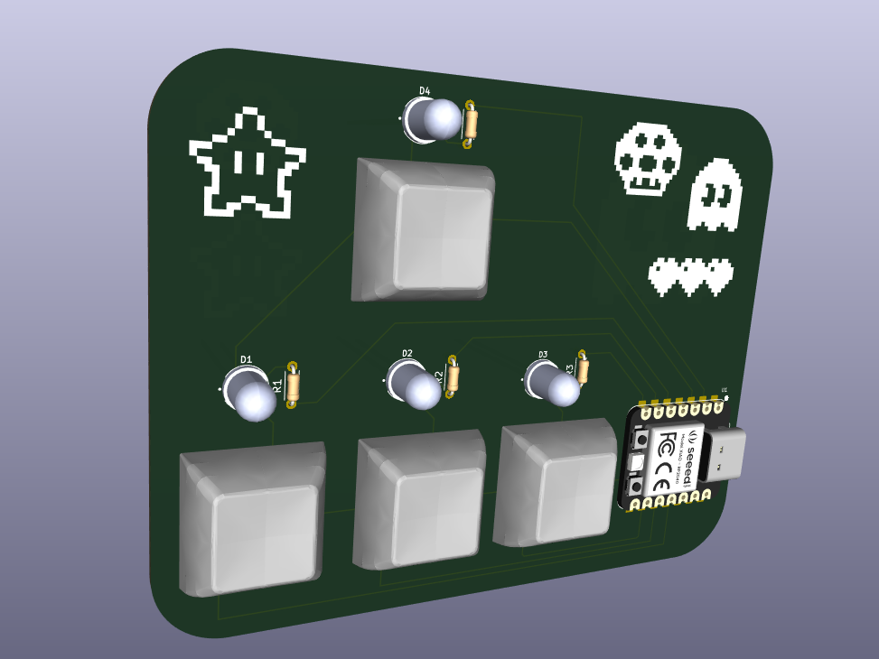
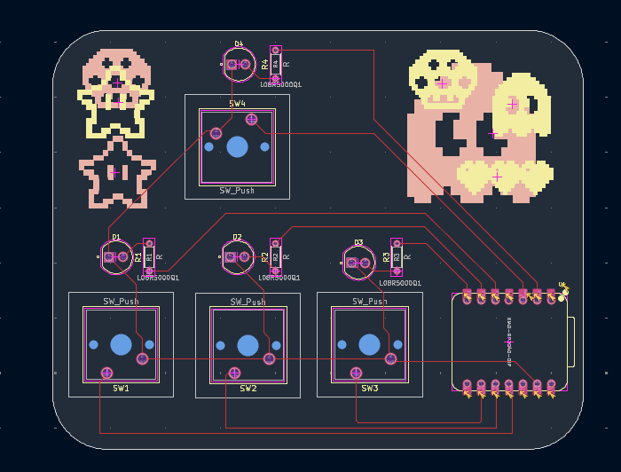
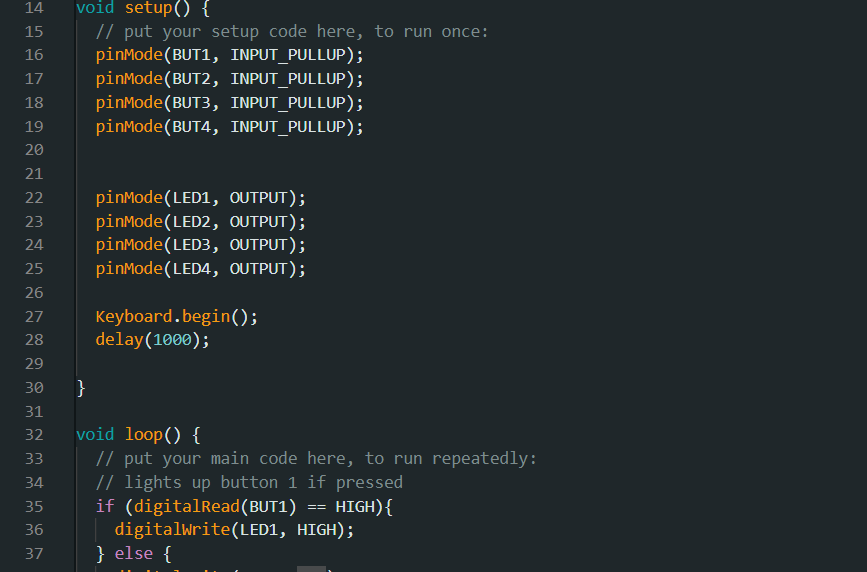

# Pathfinder
For week four of Half Life I created a board that can be used for multiple things.

## Fidget...
The board can be used as a fidget with 4 buttons when it is not plugged into the computer

## ...and Play Games
I programed the board where the 4 buttons can be used to play arrow/WASD games!

## Additionally, Try a Simon Says & Wack-A-Mole Game
I also made a simon says and wack-a-mole game that people can play if they want to stop using the device to play games!

## Programs Used
For this project I used KiCAD for making the board and Arduino IDE to code the board.

## Future!
Since I can change the code in the future, this can also be used to play different games. For example, some used this to play a morse code or guess-the-seconds type games!